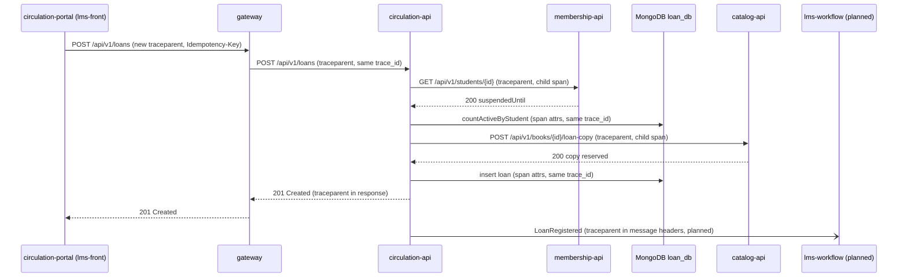

# CP1 - Critical journey and trace map

## Journey: HU-06 Register a loan

A librarian registers a loan from the Loans screen. `circulation-api` orchestrates the use case
(`LoanRegistrationService.RegisterLoan`) and needs membership, catalog and its own MongoDB.
If this journey fails, no book leaves the library, so it is the most critical one in the LMS.

Components crossed: `lms-front` (shell) + `lms-circulation-portal`, gateway (nginx in local),
`circulation-api`, `membership-api`, `catalog-api`, MongoDB `loan_db`, PostgreSQL `lms_db`.

## Hop table

| Step | Caller | Receiver | Protocol | Operation | Sync/Async | Data touched |
|---|---|---|---|---|---|---|
| 1 | lms-circulation-portal (inside lms-front shell) | gateway | REST | `POST /api/v1/loans` | sync | none |
| 2 | gateway | circulation-api | REST | `POST /api/v1/loans` | sync | none |
| 3 | circulation-api | membership-api | REST + internal HS256 token | `GET /api/v1/students/{id}` (eligibility, `suspendedUntil`) | sync | `membership.student` (PostgreSQL) |
| 4 | circulation-api | MongoDB `loan_db` | Mongo wire | count active loans of the student (INV-004, max 2) | sync | `loans` collection |
| 5 | circulation-api | catalog-api | REST + internal HS256 token | `POST /api/v1/books/{id}/loan-copy` | sync | `catalog.book` (PostgreSQL) |
| 6 | circulation-api | MongoDB `loan_db` | Mongo wire | insert loan (`dueDate` = today + 7 days) | sync | `loans`, `idempotency_keys` |
| 7 (planned) | lms-workflow | lms-worker | message broker | `LoanRegistered` event (saga, ADR-008) | async | queue |

Step 7 does not exist yet: `lms-workflow` and `lms-worker` are still empty. It is included to show
where the trace must cross an asynchronous boundary once the saga is built.

## Trace context today vs. target

- Today the only context is `X-Correlation-Id`. The `CorrelationID` middleware creates it in each API
  and returns it in the response, but `membershipclient` and `catalogclient` do **not** forward it,
  so hops 3 and 5 start a new id and the logs of three services cannot be joined.
- Target: W3C `traceparent` (`00-<trace_id>-<span_id>-01`) read or created at the gateway, copied by
  every outbound client, and written in the message headers for step 7. `X-Correlation-Id` is kept
  for the user-facing `traceId` in error bodies.

## Sequence diagram



## Span tree

```
[root] gateway POST /api/v1/loans                          trace_id=T
  └─ circulation-api POST /api/v1/loans (server)           parent=gateway
       ├─ LoanRegistrationService.RegisterLoan (internal)
       │    ├─ membershipclient GET /students/{id} (client)
       │    │    └─ membership-api GET /api/v1/students/{id} (server)
       │    │         └─ postgres SELECT membership.student
       │    ├─ mongo loans.countDocuments (client)
       │    ├─ catalogclient POST /books/{id}/loan-copy (client)
       │    │    └─ catalog-api POST /api/v1/books/{id}/loan-copy (server)
       │    │         └─ postgres UPDATE catalog.book
       │    └─ mongo loans.insertOne (client)
       └─ (planned) publish LoanRegistered (producer)
            └─ lms-worker consume LoanRegistered (consumer)  same trace_id=T, link to producer span
```
