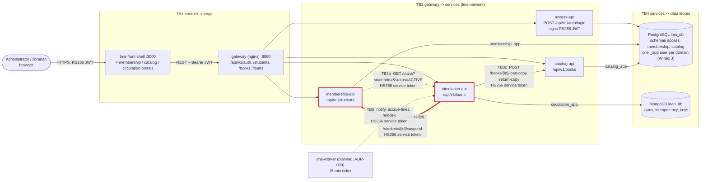

# CP1 - Attack surface and trust boundaries

System: LMS-LIBRARY-V1 after the repo-per-context split (ADR-006), as it runs today in develop.
Sources: `05-architecture/overview.md`, `09-microservices/service-catalog.md`,
`09-microservices/communication-patterns.md`, `05-architecture/security-threat-model.md`.

My boundary: **TB3a - circulation-api -> membership-api** (highlighted in red).

## Data flow diagram

TB3 (service -> service) is not a subgraph because the calls go container to container over
`lms-network` and never pass through the gateway (`communication-patterns.md`). There is no broker
and no external API today: lms-workflow and lms-worker have no running code yet.

| Boundary | From (less trusted) | To (more trusted) | How it is crossed today |
|---|---|---|---|
| TB1 | browser on the internet | lms-front, gateway | HTTP in local (HTTPS required in prod, NFR-004) |
| TB2 | gateway | access, membership, catalog, circulation | Bearer RS256 JWT checked by each API |
| **TB3a** | **circulation-api** | **membership-api** | **HS256 service token, 1 min `exp`, `sub: circulation-service`** |
| TB3b | membership-api | circulation-api | HS256 service token (deactivation check, HU-03) |
| TB3c | circulation-api | catalog-api | HS256 service token |
| TB4 | each API | PostgreSQL / MongoDB | one user per domain with grants only on its schema (Annex J) |
| TB5 | lms-worker (planned) | circulation-api, catalog-api | HS256 service token |

## Asset inventory (membership domain and my boundary)

| Asset | Where it lives | Classification |
|---|---|---|
| Student PII: full name, email, phone, document ID | `membership.student` (PostgreSQL), returned by `GET /api/v1/students/{id}` | confidential |
| Suspension state `suspended_until` (INV-006, HU-08) | `membership.student` | internal |
| Deactivation state `deactivated_at` (HU-03) | `membership.student` | internal |
| `INTERNAL_JWT_SECRET` (HS256 shared secret) | env vars of membership-api, circulation-api, catalog-api | restricted |
| Student UUID used as `studentId` in loans | `membership.student.id`, `loans.studentId` (MongoDB) | internal |
| `membership_app` DB credentials | env vars of membership-api | restricted |
| Idempotency keys for registration | `membership.idempotency_key` | internal |

## Entry points of TB3a (circulation-api -> membership-api)

| Entry point | Called by | Port / network | Auth today | Data in / out |
|---|---|---|---|---|
| `GET /api/v1/students/{id}` | circulation-api `membershipclient.IsEligible` (HU-06) | membership-api :8080 inside lms-network (8081 on the host in lms-qa) | HS256 token, signed with `INTERNAL_JWT_SECRET` | in: student UUID; out: the full student JSON (PII), circulation only reads `suspendedUntil` |
| `POST /api/v1/students/{id}/suspend` | circulation-api `membershipclient.Suspend` on a late return (HU-08) | same | same HS256 token | in: `{"days": 3}`; out: student JSON |

What the code accepts today (`middleware/auth.go` in lms-membership-api): `RequireAuth` takes
**either** an RS256 admin token **or** any HS256 token signed with the shared secret, and applies it
to the whole `/students` group. There is no per-route rule, no `aud`/`scope` claim and no check
that the HS256 `sub` is really `circulation-service`.
