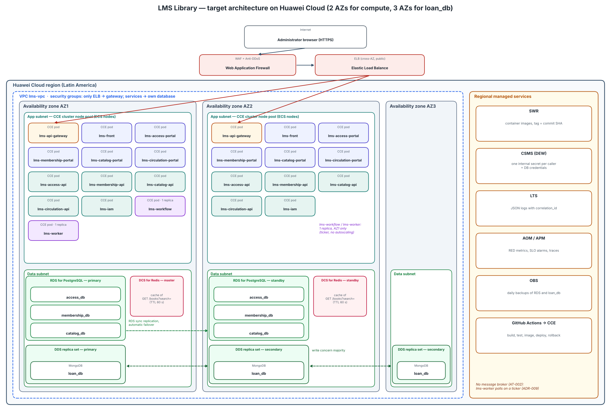

# Architecture design note — LMS Library

## 1. Target architecture

| Component in the diagram | Defined in (file of your team's -docs) |
|---|---|
| `lms-api-gateway` | `05-architecture/decisions/records/ADR-003-nginx-reverse-proxy.md`, `05-architecture/decisions/records/ADR-007-gateway-auth-and-rate-limiting.md` |
| `lms-front` | `05-architecture/overview.md` (sections 3 and 4) |
| `lms-access-portal` | `05-architecture/decisions/records/ADR-011-access-service-node-vue-exception.md` |
| `lms-membership-portal`, `lms-catalog-portal`, `lms-circulation-portal` | `05-architecture/overview.md` (section 4, remotes of `lms-front`) |
| `lms-access-api` | `05-architecture/overview.md` (sections 4 and 7), `05-architecture/decisions/records/ADR-011-access-service-node-vue-exception.md` |
| `lms-membership-api` | `05-architecture/overview.md` (section 4) |
| `lms-catalog-api` | `05-architecture/overview.md` (section 4) |
| `lms-circulation-api` | `05-architecture/overview.md` (section 4), `05-architecture/decisions/records/ADR-005-mongodb-for-circulation-service.md` |
| `lms-iam` | `05-architecture/decisions/records/ADR-012-iam-service-scope.md` |
| `lms-workflow` | `05-architecture/decisions/records/ADR-008-circulation-saga-scope.md` |
| `lms-worker` | `05-architecture/decisions/records/ADR-009-worker-scheduling-model.md` |
| PostgreSQL `access_db`, `membership_db`, `catalog_db` | `06-data/models.md`, `06-data/data-dictionary.md`, `05-architecture/overview.md` (principle P2) |
| MongoDB `loan_db` | `06-data/models.md` (Module: Circulation), `05-architecture/decisions/records/ADR-005-mongodb-for-circulation-service.md` |
| Liquibase migrations (`lms-*-db`) | `05-architecture/decisions/records/ADR-010-liquibase-for-database-migrations.md`, `06-data/migration-strategy.md` |
| Broker: none | `05-architecture/overview.md` (section 8, AT-002) |

Today the whole LMS runs with Docker Compose on one host (`05-architecture/deployment.md`), so one
machine going down stops every loan at the desk. In the target I keep the same containers and names,
but I run them as workloads in one CCE cluster whose nodes are split between AZ1 and AZ2 of the same
region, behind an ELB and a WAF. The three PostgreSQL databases move to one RDS for PostgreSQL
instance with the primary in AZ1 and the standby in AZ2, and `loan_db` moves to a DDS replica set
with one member in each of three AZs. I do not add a message broker: the team registered AT-002 on
purpose and `lms-worker` already works by polling (ADR-009), so a broker would be new infrastructure
without a consumer that needs it.

## 2. Five principles

| Principle | Current weakness | Evidence in -docs | Design decision | Huawei Cloud service |
|---|---|---|---|---|
| Reliability | Every container runs on a single Docker host, and Circulation calls Membership and Catalog with no retry or circuit breaker. If the host or one service fails, loan registration stops. | `05-architecture/deployment.md` (section 1), `05-architecture/overview.md` (P3, P5 and AT-002) | Run every stateless service with at least 2 replicas, one per AZ, behind a load balancer that only sends traffic to pods whose `GET /health/ready` answers 200. | CCE (node pool in AZ1 and AZ2), ELB |
| Security | All services sign internal HS256 tokens with one shared `INTERNAL_JWT_SECRET`. SEC-10 was deferred "until the system runs on more than one host". | `05-architecture/decisions/records/ADR-013-internal-caller-allowlist.md`, `05-architecture/decisions/records/ADR-004-incremental-microservices-decomposition.md` | One secret per calling service, kept in a secrets manager, injected into the pod at deploy time and rotated. WAF in front of the ELB. (ADR-C3-02) | CSMS (DEW), WAF |
| Performance efficiency | No cache exists, and a loan chains synchronous calls (circulation → membership → catalog), so every extra hop adds latency to the critical `POST /loans`. | `05-architecture/overview.md` (sections 6 and 7), `09-microservices/communication-patterns.md` | Cache `GET /books?search=` results in Redis for 60 s and keep the loan path uncached, so a suspended student is never read from a stale cache. | DCS for Redis (master/standby in AZ1 and AZ2) |
| Cost | The load is one library desk during opening hours, but every environment keeps its containers and databases running 24/7, and nothing scales down at night or on weekends. | `01-context/scope.md` (assumption 4), `05-architecture/overview.md` (P2, P5) | One RDS primary/standby pair that hosts `access_db`, `membership_db` and `catalog_db` as separate databases with separate users, instead of one HA pair per database. The qa node pool runs pay-per-use and is scaled to 0 outside class hours. | RDS for PostgreSQL, CCE node pool on pay-per-use |
| Operations | Only JSON logs and `/health` exist. Metrics and traces are planned but not built, and deployment is a manual `docker compose up`. | `04-requirements/non-functional.md` (NFR-005), `13-operations/observability.md`, `10-devops/environments.md` | Ship the existing JSON logs (with `correlation_id`) to a log service, export RED metrics with alarms on the SLO, and deploy only through the pipeline in section 5. | LTS, AOM, APM, SWR |

For me the most urgent row is Security, even more than Reliability. ADR-013 says SEC-10 can wait
only while everything runs on one host. As soon as the LMS runs on several nodes in two AZs, that
condition is gone, and one leaked secret would let any pod call any route, the same elevation of
privilege I modeled in week 13. Reliability is the second one because the single host is the most
likely way the system stops at the counter.

## 3. Scalability

| Service | Scaling metric | Threshold (number and unit) | Min instances | Max instances |
|---|---|---|---|---|
| `lms-circulation-api` | Average CPU usage of the pods | 70 % | 2 | 3 |
| `lms-catalog-api` | Requests per second per pod | 10 req/s | 2 | 3 |

I picked these two because they serve the three critical endpoints of NFR-001 (`POST /loans`,
`POST /returns` and `GET /books?search=`) and they keep no state in memory, as NFR-003 asks. The 70 %
CPU threshold and the maximum of 3 instances come straight from NFR-003. The minimum is 2 and not 1
so each AZ always keeps one pod. For catalog I scale on requests instead of CPU because search
waits mostly on PostgreSQL: with 10 req/s per pod, two pods cover the 20 RPS of NFR-001, and the third
one absorbs the 2x burst of NFR-003. I do not autoscale `lms-worker` or `lms-workflow`. Both run on an
internal ticker (every 15 minutes in `lms-worker`), so load is never their problem, and two copies of
`lms-worker` would run the fines accrual job twice on the same overdue loan. They stay at one replica
until the jobs have a lease or an idempotency check by `loan_id`.

## 4. Disaster recovery

- Critical data store: `loan_db` (MongoDB, `loans` and `idempotency_keys` collections)
- RTO: 5 minutes
- RPO: 0 minutes
- DR pattern (chapter 11): cross-AZ hot standby inside one region (DDS replica set with one member in each of three AZs)
- Why the pattern meets those numbers: Circulation will write every loan with write concern `majority`, so a loan is confirmed only after it is stored in a second AZ, and losing one AZ cannot lose a confirmed loan (RPO 0). When the primary fails, the two remaining members still hold a majority and elect a new primary in less than a minute; the driver reconnects through the replica set URI, which fits easily inside the 5-minute RTO.

I chose `loan_db` over the PostgreSQL databases because it is the only place that knows who has
which book. If it is lost, the copies stay reserved in `catalog_db` with no loan behind them, and
nobody can tell which student must return what. Today NFR-008 promises an RPO of 24 hours with a
daily backup, which for loans means a full day of desk work typed again from paper. I use three AZs
instead of two because with only two members a single failure leaves no majority to elect a new
primary. Replication also copies mistakes, so I keep the daily automated backup to OBS as a second
line for a bad deletion. The CI of `lms-circulation-db` and its compose file already connect with
`replicaSet=rs0`, so the code is used to talking to a replica set.

## 5. Automated deployment

| Stage | Trigger | Tool or service | File in your team's repositories |
|---|---|---|---|
| Build | Pull request to `develop`, `qa` or `main` | GitHub Actions (gofmt, go vet) | `lms-circulation-api/.github/workflows/ci.yml` |
| Test | Same pull request | GitHub Actions (`go test ./... -cover`; Liquibase update from an empty `loan_db` and a second update that must apply 0 changesets) | `lms-membership-api/.github/workflows/ci.yml`, `lms-circulation-db/.github/workflows/db-ci.yml` |
| Image | Merge into `develop` (target) | GitHub Actions builds the multi-stage image and pushes it to SWR tagged with the commit SHA | `lms-circulation-api/deploy/Dockerfile` |
| Deploy to qa | Pull request from a `qa/` branch (commit re-applied with `cherry-pick -x`) merged into `qa` | GitHub Actions runs the Liquibase update and then a rolling update of the qa namespace in CCE (target; today this is the manual compose file) | `lms-api-gateway/deploy/compose.yml` |
| Deploy to production | Pull request from `release/X.Y.Z` merged into `main` (needs the approval of the teacher, `ariel5253`) | GitHub Actions, rolling update in the prod namespace of CCE with `maxUnavailable: 0`, using the same image that passed qa | `library-docs/00-governance/branching-policy.md` |
| Rollback | Pods fail `/health/ready` after a deploy, or the SLO alarm fires in AOM | `kubectl rollout undo` to the previous SWR tag; database changes undone with the Liquibase rollback scripts | `lms-access-db/05_rollbacks/` |

The first two stages already exist and run on every pull request in the code repositories, with
the gates of `branching-policy.md`. What is missing is everything after the merge: the team has no image
registry, no job that deploys to qa or production, and no automatic rollback of the application.
Today a deploy means someone running the compose files by hand. I keep GitHub Actions because the
team already knows it, and I only add SWR as the registry and CCE as the target. Tagging images with
the commit SHA is what makes the rollback one command: the previous version is still in SWR.

## 6. Decisions

- [ADR-C3-01](ADR-C3-01.md): Replicate `loan_db` as a DDS replica set across three availability zones
- [ADR-C3-02](ADR-C3-02.md): Give each calling service its own internal token secret, stored in CSMS
